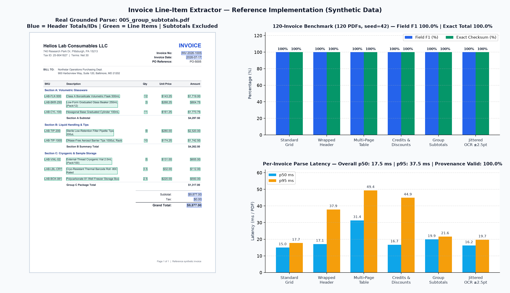

# Invoice Line-Item Extractor

**Reference implementation · synthetic data**

Automated AP and procurement pipelines break when multi-line invoice descriptions, group subtotals, or OCR coordinate jitter cause line-item sums to drift from the invoice grand total without an auditable trail back to the PDF.



## Quick start

```bash
uv sync && make eval
make test
```

## Reproducible in-distribution benchmark (`120` synthetic PDFs, `seed=42`)

Metrics below are produced directly by `make eval` (`uv run invoice-extractor eval --count 120 --seed 42` -> [`reports/eval_summary.json`](reports/eval_summary.json)) and measure **in-distribution** extraction across the `6` synthetic generator layouts (`no` held-out external vendor layouts are included in this benchmark):

| Metric | Result |
| :--- | :--- |
| Dataset | `120` synthetic PDFs across `6` generator layouts (`20` per layout, `seed=42`, in-distribution) |
| Line-Item Precision / Recall / F1 | `1.0000` / `1.0000` / `1.0000` |
| Header Field Precision / Recall / F1 | `1.0000` / `1.0000` / `1.0000` |
| Overall Field Precision / Recall / F1 | `1.0000` / `1.0000` / `1.0000` |
| Exact Grand-Total Checksum Pass | `120 / 120` (`100.00%`) |
| Token BBox Provenance Validity | `100.00%` |
| Per-Invoice Latency (`p50` / `p95` / `mean`) | `17.457 ms` / `37.485 ms` / `21.555 ms` |

### Per-layout breakdown

| Layout | Count | Field F1 | Exact Total Pass | BBox Valid | p50 (ms) | p95 (ms) |
| :--- | :---: | :---: | :---: | :---: | :---: | :---: |
| `standard_grid` | 20 | `1.0000` | `100.0%` | `100.0%` | `14.998` | `17.739` |
| `wrapped_header` | 20 | `1.0000` | `100.0%` | `100.0%` | `17.138` | `37.891` |
| `multipage_table` | 20 | `1.0000` | `100.0%` | `100.0%` | `31.357` | `49.376` |
| `credits_discounts` | 20 | `1.0000` | `100.0%` | `100.0%` | `16.718` | `44.906` |
| `group_subtotals` | 20 | `1.0000` | `100.0%` | `100.0%` | `19.918` | `21.623` |
| `jittered_ocr_layout` | 20 | `1.0000` | `100.0%` | `100.0%` | `16.218` | `19.709` |

## What breaks in production & how this handles it

1. **2-line split column headers** (`QTY / UNIT`, `EXT'D / NET`) — [`_detect_header_in_rows()`](src/invoice_extractor/parser.py) and [`_cluster_header_columns()`](src/invoice_extractor/parser.py) merge vertically adjacent header rows (`<= 10pt` gap) and cluster tokens horizontally before inferring right-edge numeric anchors via median `x1` clustering.
2. **Wrapped descriptions without qty/price columns** — [`_parse_table_rows()`](src/invoice_extractor/parser.py) stitches description-column continuation rows onto the active line item, resets active state at section headers or subtotals, and builds a union bounding box via [`build_provenance()`](src/invoice_extractor/grounding.py).
3. **Group subtotals double-counting line sums** — [`_parse_table_rows()`](src/invoice_extractor/parser.py) separates definite line items (verified `qty`/`unit_price`/`amount` or confirmed `SKU` + description + amount) from labeled subtotal rows and ambiguous amount-only rows. [`disambiguate_candidate_rows()`](src/invoice_extractor/parser.py) uses [`_find_subset_with_status()`](src/invoice_extractor/parser.py) strictly over ambiguous rows without ever dropping definite verified line items, honestly marking `checksum_passed=False` if sums disagree or `max_states` is reached without an unambiguous match.
4. **Floating-point cent rounding drift** — [`parse_currency_cents()`](src/invoice_extractor/grounding.py) and [`parse_decimal_qty()`](src/invoice_extractor/grounding.py) convert grouped (`$1,240.00`), ungrouped 4+ digit (`$1240.00`, `1240.00`), and negative formats (`($1240.00)`, `(1240.00)`, `-$1240.00`, `-1240.00`) into exact `int` cents and `Decimal` quantities (while rejecting malformed groupings like `$1,24.00` or multi-dot strings) before reconciling `sum(line_items) == subtotal` and `subtotal + tax - credits == total`.
5. **Ungrounded or cross-row LLM hallucinations** — [`apply_strict_fallback()`](src/invoice_extractor/llm_fallback.py) enforces a strict checksum gate (`checksum_passed == False` only), validates the JSON schema, checks exact per-line arithmetic (`qty * unit_price_cents == amount_cents`, `<= 1` cent tolerance only for fractional quantities), verifies same-page horizontal row co-location across `SKU`/`description`/`qty`/`unit_price`/`amount` tokens (`|y_mid_a - y_mid_b| <= row_tol`), and enforces unique `(page, token_idx)` consumption so no PDF token can be reused across line items or summary fields.

## Limitations

- `1.0000` F1 reflects an in-distribution benchmark across the `6` deterministic synthetic vendor layouts (`120` PDFs); no held-out external vendor layouts are included in this repo, and unseen production layouts with rotated tables, merged multi-currency columns, or handwritten annotations may fail the deterministic checksum and trigger the fallback gate.
- Designed for born-digital PDFs or OCR-word-boxed PDFs that carry token bounding-box coordinates; raw raster images or un-OCRed scans require an upstream OCR box provider (such as Tesseract, PaddleOCR, or DocumentAI) before calling the geometry engine.
- Ships with offline `disabled` and `mock` fallback providers configured via `INVOICE_EXTRACTOR_FALLBACK_MODE` (default `disabled`) or `--fallback-mode` so zero external API keys or network calls are required.

## CLI commands

```bash
uv run invoice-extractor generate --count 120 --seed 42
uv run invoice-extractor extract data/generated/pdfs/001_standard_grid.pdf
uv run invoice-extractor eval --count 120 --seed 42
```

Built with AI-assisted tooling; architecture, review, and tests by me.
